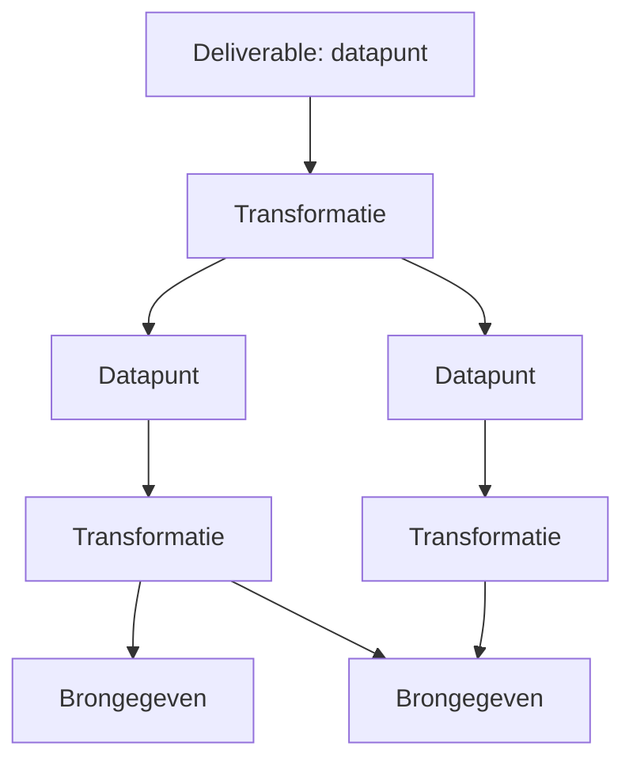

# Flow Visualiser: ankerpunt

Dit document is de bron van waarheid voor visie, domeinmodel, gedrag en technische keuzes. Bij twijfel geldt dit document. Wijzigingen aan beslissingen worden vastgelegd in sectie 9.

## 1. Uitgangspunt en visie

We willen historisch scheef gegroeide processen binnen een zorgverzekeraar niet alleen sneller uitvoeren of automatiseren. We willen onderzoeken wat werkelijk nodig is om het gewenste resultaat te bereiken.

We beginnen daarom niet bij de huidige werkwijze, maar bij de deliverable:

> **Welk resultaat moeten we opleveren, welke gegevens zijn daarvoor nodig en welke logica maakt van die gegevens een betrouwbare uitkomst?**

De digitale deliverable is een datapunt of samenhangend gegevensobject, zoals een vastgesteld bedrag, een onderbouwde beslissing of een volledig verrijkt record. Vanuit die uitkomst redeneren we terug tot duidelijk is welke brongegevens, bewerkingen en beoordelingen nodig zijn.

### Van proces naar data

| Procesgericht | Datagericht |
|---|---|
| Welke stappen voeren we uit, in welke volgorde en door wie? | Wat moeten we weten, waar komt het vandaan en hoe bepalen we daarmee het resultaat? |

Een handeling, systeem of organisatorische grens is niet automatisch een vereiste voor het toekomstige ontwerp. We onderscheiden:

- **Wat noodzakelijk is:** gegevens, logica, kwaliteitscriteria en randvoorwaarden.
- **Hoe het nu gebeurt:** systemen, overdrachten, handmatig werk. **Buiten de scope van deze tool.**
- **Hoe het straks kan gebeuren:** een nog te kiezen inrichting. Ook buiten v1.

De tool schetst uitsluitend de **SOLL-situatie**: wat nodig is. De analyse van de huidige situatie en het terugredeneren gebeuren buiten de tool, in de analysefase.

## 2. Principes

1. **Data boven proces.** Het model bevat datapunten en transformaties, geen stappen, rollen of volgorde.
2. **SOLL-only.** Geen velden voor huidige systemen of werkwijzen.
3. **Alleen labels, nooit waarden.** De tool bevat namen, definities en beschrijvingen van gegevens. Nooit echte persoons-, polis- of medische gegevens. Dit is een harde ontwerpregel (AVG).
4. **Lokaal.** Geen backend, geen externe diensten, geen telemetrie. Alle data blijft op de machine van de gebruiker.
5. **Zichtbare onzekerheid.** Aannames, ontbrekende gegevens en onbeschreven logica zijn eersteklas informatie, geen bijzaak.
6. **Signaleren, niet afdwingen.** De tool wijst op problemen maar blokkeert niets.
7. **Eén gebruiker.** Geen accounts, rechten of real-time samenwerking.

## 3. Domeintaal

| Nederlands (UI en documentatie) | Engels (code en datamodel) |
|---|---|
| canvas | `Canvas` |
| proces | `Process` |
| deliverable | `Deliverable` (vlag op een datapunt) |
| datapunt | `DataPoint` |
| catalogusitem | `CatalogItem` |
| data catalogus | `Catalog` |
| transformatie | `Transformation` |
| brongegeven | `source` (afgeleide rol) |
| tussenresultaat | `intermediate` (afgeleide rol) |
| eindresultaat | `result` (afgeleide rol) |
| bekend / aanname / ontbrekend | `known` / `assumed` / `missing` |
| beschreven / onbeschreven / aanname | `described` / `undescribed` / `assumed` |
| gat | `gap` |
| afhankelijkheid | `dependency` (edge) |

## 4. Domeinmodel

### 4.1 Overzicht

Pijlen lopen van het resultaat naar wat daarvoor nodig is (de leesrichting "wat heb je nodig?"). Het onderliggende model is een gerichte graaf (netwerk). Het toont als boom met de deliverable bovenaan. Een gedeeld knooppunt blijft één element.

### 4.2 Canvas

Een canvas is een losse save file met meerdere processen. Bevat: metadata (naam, schemaversie, tijdstempels), datapunten, transformaties, afhankelijkheden, processen en een snapshot van de gebruikte catalogusitems bij export.

### 4.3 Catalogusitem (`CatalogItem`)

De data catalogus voorkomt dat terminologie door elkaar loopt. Globaal over alle canvassen.

| Veld | Opmerking |
|---|---|
| term | unieke naam |
| definitie | vrije tekst |
| synoniemen | optioneel |
| afgekeurde termen | "gebruik niet: ..." |
| eigenaar | vrije tekst |
| kwaliteitscriteria | vrije tekst |
| kardinaliteit | enkelvoudig of lijst. Informatief, geen invloed op verbindingen |

### 4.4 Datapunt (`DataPoint`)

Een voorkomen van een catalogusitem in een canvas. Verwijzing naar de catalogus is verplicht. Item aanmaken moet ter plekke kunnen zonder de flow te verlaten.

| Veld | Opmerking |
|---|---|
| catalogusverwijzing | verplicht. Naam, definitie en kwaliteitscriteria komen uit de catalogus |
| status | `known`, `assumed`, `missing` |
| deliverable | vlag, gekoppeld aan een proces |
| notities | vrije tekst |

**Afgeleide rol** (nooit handmatig):
- `source`: geen producerende transformatie.
- `intermediate`: heeft een producerende transformatie en wordt als input gebruikt.
- `result`: heeft een producerende transformatie en wordt niet als input gebruikt (of is deliverable).

Een datapunt heeft **hoogstens één producerende transformatie**. Alternatieven worden binnen de transformatie beschreven als beslisregel.

### 4.5 Transformatie (`Transformation`)

Wat nodig is om van input naar output te komen.

| Veld | Opmerking |
|---|---|
| naam | vrije tekst |
| type | berekening, beslisregel, opzoeking, extractie, validatie, menselijke interpretatie |
| logica | vrije tekst |
| status | `described`, `undescribed`, `assumed` |
| notities | vrije tekst |

Vorm: **meerdere inputs, precies één output**. Meerdere outputs zijn meerdere transformaties. De output mag inhoudelijk een lijst zijn. Dat is een eigenschap van het catalogusitem en heeft geen invloed op de verbinding.

### 4.6 Proces (`Process`)

Een proces is de hele beslisboom van één of meer deliverables. Het heeft naam en beschrijving. Lidmaatschap is **afgeleid**: alles wat vanaf de deliverables van het proces bereikbaar is. Een datapunt in meerdere processen krijgt een "gedeeld"-indicator. Een proces werkt als filter en kleur, niet als aparte graaf.

## 5. Gedrag

### 5.1 Gaten

Een **gat** is een datapunt met status `missing` of `assumed`, of een transformatie met status `undescribed` of `assumed`.

- Elk element toont zijn status met een duidelijk icoon.
- Elk knooppunt toont **"onderliggende gaten: n"** (aantal gaten in de onderliggende boom). Dit is een telling, geen betrouwbaarheidsscore.
- Per deliverable is er een **gatenoverzicht**.

### 5.2 Signalering in plaats van validatie

De tool legt geen harde regels op. Wel wijst de UI (ook in het gatenoverzicht) op:

- cycli (blijven tekenbaar, terugverwijzende pijlen apart weergegeven)
- transformatie zonder input of zonder output
- datapunt zonder producerende transformatie (brongegeven: "waar komt dit vandaan?")
- elementen die bij geen enkel proces horen

### 5.3 Weergave en interactie

- Volledig automatische **top-down layout** (deliverable bovenaan, bijvoorbeeld met ELK). Geen handmatig verslepen.
- Deelbomen zijn in te klappen.
- Snelle invoer via het toetsenbord.
- Undo/redo.
- Filter en kleur per proces.

## 6. Opslag en delen

- **IndexedDB** (via Dexie) in de browser. Geen localStorage vanwege de limiet en structuur.
- Elk canvas is een afzonderlijke save file in de lijst met canvassen.
- De **catalogus** is globaal en staat in eigen opslag.
- **JSON-export en -import** van een canvas voor delen en back-up. Het exportbestand bevat een `schemaVersion` en een snapshot van de gebruikte catalogusitems, zodat het zelfstandig te openen is.
- Bij import worden catalogusitems samengevoegd met melding bij conflicten (zelfde term, andere definitie).
- Migraties op `schemaVersion` zijn verplicht bij modelwijzigingen.
- Let op: IndexedDB is gebonden aan adres en poort. Daarom draait de app altijd op dezelfde vaste poort.

## 7. Technische keuzes

| Onderdeel | Keuze |
|---|---|
| Taal | TypeScript |
| UI | React + Vite |
| Canvas | React Flow (xyflow) |
| Layout | ELK (of dagre) |
| Opslag | IndexedDB via Dexie |
| Backend | geen |
| Taal UI | Nederlands |
| Taal code en datamodel | Engels |

### Draaien

- Voor ontwikkeling: `npm run dev`.
- Voor gebruik: een statische build (`dist`), geserveerd door één zelfstandige **Windows `.exe`** in de bronmap (voorstel: Go, bevat de build, geen Node of Python nodig). De exe serveert op een **vaste poort (4173)**, opent de browser en geeft een duidelijke foutmelding als de poort bezet is.
- De JSON-export blijft de back-up.
- Mogelijk gevolg: SmartScreen-waarschuwing bij een niet-gesigneerde exe.

## 8. Scope

### v1

- Meerdere canvassen als save files
- Globale data catalogus
- Datapunten, transformaties, afhankelijkheden, deliverables, processen
- Statussen, gaten, gatenoverzicht en teller
- Automatische top-down layout met inklappen
- Signalering
- Undo/redo
- Opslag in IndexedDB, JSON-export en -import
- Launcher-exe

### Roadmap (niet in v1)

- Snapshots van canvassen
- Catalogus van herbruikbare transformaties
- Bibliotheek met delen tussen canvassen
- Voorstellen voor modules en development
- Variant als enkel HTML-bestand
- Eventueel desktop-app (Tauri), met opslag in bestanden
- Handmatige layout, lagen "nu" en "straks"

## 9. Beslissingen en open vragen

### Beslissingenlog

| # | Beslissing |
|---|---|
| 1 | Tool schetst alleen de SOLL-situatie. Geen huidige-situatie-velden. |
| 2 | Eén gebruiker, volledig lokaal. |
| 3 | Alleen labels en beschrijvingen, nooit inhoudelijke waarden. |
| 4 | Canvas = save file. Catalogus globaal, snapshot mee bij export. |
| 5 | Datapunt verwijst verplicht naar catalogusitem. |
| 6 | Transformatie: n inputs, één output. Hoogstens één producerende transformatie per datapunt. |
| 7 | Proces = beslisboom van één of meer deliverables, afgeleid. |
| 8 | Geen harde validaties, alleen signalering. |
| 9 | Automatische top-down layout, geen handmatig verslepen. |
| 10 | Undo/redo en JSON-export in v1, snapshots later. |
| 11 | Draaien via zelfstandige exe op vaste poort. |

### Open vragen

- Exacte layoutweergave van cycli.
- Keuze tussen ELK en dagre na een proef met gedeelde knooppunten.
- Handtekening of distributie van de exe.

## 10. Regels voor AI-agents

Zie ook `AGENTS.md`.

1. Lees dit document eerst. Wijkt een verzoek ervan af, vraag dan of de beslissing moet wijzigen en werk sectie 9 bij.
2. Voeg nooit velden toe voor huidige werkwijzen, systemen of uitvoerders (SOLL-only).
3. Sla nooit inhoudelijke waarden of persoonsgegevens op. Ook niet in voorbeelden of testdata (gebruik fictieve labels).
4. Geen backend, geen externe netwerkaanroepen, geen telemetrie.
5. Bouw geen harde validaties die handelingen blokkeren. Signaleer in de UI.
6. Houd de domeintaal (sectie 3) aan: UI Nederlands, code Engels.
7. Wijzig je het opslagmodel, verhoog dan `schemaVersion` en voeg een migratie toe.
8. Voeg niets uit de roadmap toe zonder uitdrukkelijk verzoek.
