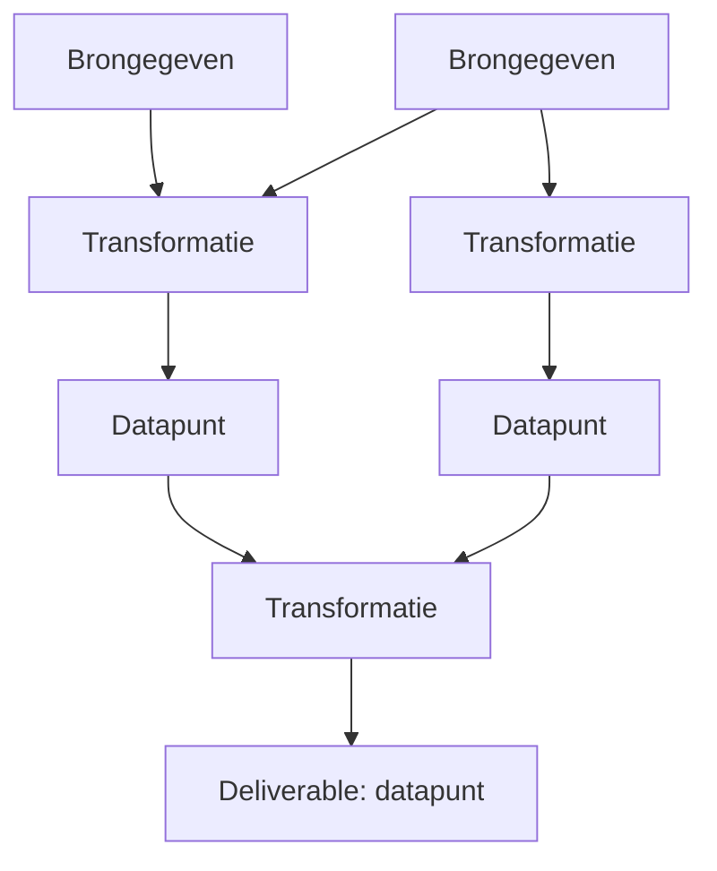

# Flow Visualiser: ankerpunt

Dit document is de bron van waarheid voor visie, domeinmodel, gedrag en technische keuzes. Bij twijfel geldt dit document. Wijzigingen aan beslissingen worden vastgelegd in sectie 9.

## 1. Uitgangspunt en visie

We willen historisch scheef gegroeide processen binnen een zorgverzekeraar niet alleen sneller uitvoeren of automatiseren. We willen onderzoeken wat werkelijk nodig is om het gewenste resultaat te bereiken.

We beginnen daarom niet bij de huidige werkwijze, maar bij de deliverable:

> **Welk resultaat moeten we opleveren, welke gegevens zijn daarvoor nodig en welke logica maakt van die gegevens een betrouwbare uitkomst?**

De digitale deliverable is een datapunt of samenhangend gegevensobject, zoals een vastgesteld bedrag, een onderbouwde beslissing of een volledig verrijkt record. Vanuit die uitkomst redeneren we terug tot duidelijk is welke brongegevens, bewerkingen en beoordelingen nodig zijn.

### Van proces naar data

| Procesgericht | Datagericht |
|---|---|
| Welke stappen voeren we uit, in welke volgorde en door wie? | Wat moeten we weten, waar komt het vandaan en hoe bepalen we daarmee het resultaat? |

Een handeling, systeem of organisatorische grens is niet automatisch een vereiste voor het toekomstige ontwerp. We onderscheiden:

- **Wat noodzakelijk is:** gegevens, logica, kwaliteitscriteria en randvoorwaarden.
- **Hoe het nu gebeurt:** systemen, overdrachten, handmatig werk. **Buiten de scope van deze tool.**
- **Hoe het straks kan gebeuren:** beschrijvende ontwerpmetadata bij transformaties: Forcze, API, automatisering of agentic/genAI. De app voert deze stappen niet uit.

De tool schetst uitsluitend de **SOLL-situatie**: wat nodig is. De analyse van de huidige situatie en het terugredeneren gebeuren buiten de tool, in de analysefase.

## 2. Principes

1. **Data boven proces.** Het model bevat datapunten en transformaties, geen uitvoerbare workflow, individuele uitvoerders of tijdsvolgorde. Een transformatie mag de gewenste realisatie beschrijven.
2. **SOLL-only.** Geen velden voor huidige systemen of werkwijzen.
3. **Alleen labels, nooit waarden.** De tool bevat namen, definities en beschrijvingen van gegevens. Nooit echte persoons-, polis- of medische gegevens. Dit is een harde ontwerpregel (AVG).
4. **Lokaal.** Geen backend, geen externe diensten, geen telemetrie. Alle data blijft op de machine van de gebruiker.
5. **Zichtbare onzekerheid.** Aannames, ontbrekende gegevens en onbeschreven logica zijn eersteklas informatie, geen bijzaak.
6. **Signaleren, niet afdwingen.** De tool wijst op problemen maar blokkeert niets.
7. **Eén gebruiker.** Geen accounts, rechten of real-time samenwerking.

## 3. Domeintaal

| Nederlands (UI en documentatie) | Engels (code en datamodel) |
|---|---|
| canvas | `Canvas` |
| proces | `Process` |
| deliverable | `Deliverable` (vlag op een datapunt) |
| datapunt | `DataPoint` |
| catalogusitem | `CatalogItem` |
| data catalogus | `Catalog` |
| transformatie | `Transformation` |
| brongegeven | `source` (afgeleide rol) |
| tussenresultaat | `intermediate` (afgeleide rol) |
| eindresultaat | `result` (afgeleide rol) |
| bekend / aanname / ontbrekend | `known` / `assumed` / `missing` |
| beschreven / onbeschreven / aanname | `described` / `undescribed` / `assumed` |
| onzekerheid | `gap` (bestaande interne benaming) |
| afhankelijkheid | `dependency` (edge) |

## 4. Domeinmodel

### 4.1 Overzicht

Visuele pijlen lopen van input via transformatie naar resultaat, richting de deliverable bovenaan. Ontwerpen gebeurt terugredenerend: "wat heb je nodig?". Het onderliggende model is een gerichte graaf (netwerk). Een gedeeld knooppunt blijft één element. Intern bewaren afhankelijkheden hun bestaande richting "resultaat heeft nodig": `source` is het afhankelijke resultaat, `target` het benodigde element. Layout en analyses volgen die richting; alleen de presentatie en de tekeninteractie gebruiken de omgekeerde gegevensstroom.

### 4.2 Canvas

Een canvas is een losse save file met meerdere processen. Bevat: metadata (naam, schemaversie, tijdstempels), datapunten, transformaties, afhankelijkheden, processen en een snapshot van de gebruikte catalogusitems bij export.

### 4.3 Catalogusitem (`CatalogItem`)

De data catalogus voorkomt dat terminologie door elkaar loopt. Globaal over alle canvassen.

| Veld | Opmerking |
|---|---|
| term | unieke naam |
| definitie | vrije tekst |
| synoniemen | optioneel |
| afgekeurde termen | "gebruik niet: ..." |
| eigenaar | vrije tekst |
| kwaliteitscriteria | vrije tekst |
| kardinaliteit | enkelvoudig of lijst. Informatief, geen invloed op verbindingen |

### 4.4 Datapunt (`DataPoint`)

Een voorkomen van een catalogusitem in een canvas. Verwijzing naar de catalogus is verplicht. Item aanmaken moet ter plekke kunnen zonder de flow te verlaten.

| Veld | Opmerking |
|---|---|
| catalogusverwijzing | verplicht. Naam, definitie en kwaliteitscriteria komen uit de catalogus |
| status | `known`, `assumed`, `missing` |
| deliverable | vlag, gekoppeld aan een proces |
| notities | vrije tekst |

**Afgeleide rol** (nooit handmatig):
- `source`: geen producerende transformatie.
- `intermediate`: heeft een producerende transformatie en wordt als input gebruikt.
- `result`: heeft een producerende transformatie en wordt niet als input gebruikt (of is deliverable).

Een datapunt heeft bij voorkeur **hoogstens één producerende transformatie**. Alternatieven worden binnen de transformatie beschreven als beslisregel. Een extra producerende relatie blijft bewaard en krijgt een waarschuwing; alle relaties tellen mee bij bereikbaarheid en afgeleide rollen.

### 4.5 Transformatie (`Transformation`)

Wat nodig is om van input naar output te komen.

| Veld | Opmerking |
|---|---|
| naam | vrije tekst |
| realisatietype | Forcze-uitvraag/beoordeling, API, Automatisering, Agentic/genAI; hoofdkeuze voor kaart en eigenschappen |
| logisch type | optioneel: berekening, beslisregel, opzoeking, extractie, validatie, menselijke interpretatie |
| logica | vrije tekst |
| status | `described`, `undescribed`, `assumed` |
| beschikbaarheid | `available`, `toBuild`, `undetermined`; onafhankelijk van ontwerpzekerheid |
| EPIC-nummer | optionele verwijzing, zichtbaar bij Nog te bouwen; verbergen wist de tekst niet |
| notities | vrije tekst |

Vorm: **meerdere inputs, precies één output**. Meerdere outputs zijn meerdere transformaties. De output mag inhoudelijk een lijst zijn. Dat is een eigenschap van het catalogusitem en heeft geen invloed op de verbinding.

De typespecifieke UI bevat uitsluitend beschrijvende eigenschappen:

- **Forcze:** uitvraag, beoordeling of beide, plus uitvraag- of beoordelingsinstructie.
- **API:** API-/operatienaam, beschrijving en input-/outputlabels uit de graaf. Geen requestconfiguratie of credentials.
- **Automatisering:** businessrule en beschrijving van toepassingsvoorwaarden.
- **Agentic/genAI:** taak/instructie, kaders en beschrijving van menselijke controle.

Typespecifieke teksten blijven behouden bij wisselen van type. Logica blijft dezelfde gedeelde beschrijving van de werking. Beschikbaarheid begint bij nieuwe en gemigreerde transformaties op **Nog te bepalen** en verandert de onzekerhedentelling niet. Bestaande v1-transformaties krijgen bij migratie **Automatisering**, met behoud van hun logische type, logica en relaties.

### 4.6 Proces (`Process`)

Een proces is de hele beslisboom van één of meer deliverables. Het heeft naam en beschrijving. Lidmaatschap is **afgeleid**: alles wat vanaf de deliverables van het proces bereikbaar is. Een datapunt in meerdere processen krijgt een "gedeeld"-indicator. Een proces werkt als filter en kleur, niet als aparte graaf.

## 5. Gedrag

### 5.1 Onzekerheden en aandachtspunten

Een **onzekerheid** is een datapunt met status `missing` of `assumed`, of een transformatie met status `undescribed` of `assumed`. De bestaande interne codebenaming `gap` blijft behouden.

- Elk element toont zijn status met een duidelijk icoon.
- Elk knooppunt toont **"Onderliggende onzekerheden: n"** (aantal onzekerheden in de onderliggende boom). Dit is een telling, geen betrouwbaarheidsscore.
- Per deliverable is er een **onzekerhedenoverzicht**.

Tellingen gebruiken unieke bereikbare elementen, ook bij gedeelde knooppunten en cycli. Een knooppunt telt zichzelf niet mee bij onderliggende onzekerheden; het deliverable-overzicht toont ook de eigen onzekerheid. Nieuwe datapunten beginnen als `missing`, transformaties als `undescribed`.

**Aandachtspunten** in het hoofdmenu toont één totaal: unieke onzekere elementen plus het aantal structuursignalen, binnen het actieve procesfilter of anders het hele canvas. Een element kan zowel onzeker zijn als structuursignalen hebben. Ingeklapte takken veranderen de telling niet. De dropdown splitst uit naar **Onzekerheden** en **Structuursignalen** en opent de gekozen categorie in het rechterpaneel. Onzekere elementen buiten deliverables blijven in het overzicht beschikbaar. Klikken op een aandachtspunt selecteert het element en brengt het in beeld.

### 5.2 Signalering in plaats van validatie

De tool legt geen harde regels op. Wel wijst de UI (ook onder Structuursignalen) op:

- cycli (blijven tekenbaar, terugverwijzende pijlen apart weergegeven)
- transformatie zonder input of zonder output
- datapunt zonder producerende transformatie (brongegeven: "waar komt dit vandaan?")
- elementen die bij geen enkel proces horen
- directe verbindingen tussen gegevens: "Transformatie nog niet beschreven"; de verbinding blijft bewaard

### 5.3 Weergave en interactie

- Volledig automatische **top-down layout** (deliverable bovenaan, bijvoorbeeld met ELK). Geen handmatig verslepen.
- Deelbomen zijn in te klappen.
- Toetsenbordbediening via Tab en Enter; geen eigen app-sneltoetscombinaties.
- Undo/redo.
- Filter en kleur per proces.

De werkruimte heeft links canvassen en processen, centraal de graaf en rechts eigenschappen. De volledige linkerzijbalk begint ingeklapt en is via **Navigatie** in het hoofdmenu te openen en sluiten. Deze keuze geldt alleen voor de geopende sessie. Het rechterpaneel verschijnt bij selectie of een expliciet geopende functie, en heeft altijd een sluitknop. Deselecteren sluit alleen eigenschappen; expliciet geopende panelen blijven open. Gesloten panelen geven hun ruimte volledig terug aan de graaf. Invoer begint bij de deliverable. Cyclische relaties krijgen afwijkende pijlen. Inklappen verbergt gedeelde elementen alleen als geen andere open tak ze nodig heeft. ELK is de voorkeurslayout, te verifiëren met een proef.

**Input toevoegen** op een gegevenskaart biedt een bestaand of nieuw gegeven en maakt een directe verbinding. Klik op de pijl of de plus, die bij hover of focus verschijnt, om een van de vier transformatietypen te kiezen. Invoegen vervangt uitsluitend die verbinding door twee verbindingen en een transformatie; gedeelde relaties blijven behouden. Dit is één herstelbare bewerking. Klikken op een verbinding met een bestaande transformatie opent de eigenschappen van die stap, zonder een tweede transformatie in te voegen. De ribbon vervalt: het hoofdmenu biedt alleen **+ Deliverable**, inputs en transformaties worden vanuit de boom toegevoegd.

De canvasnaam is inline aan te passen via een potlood naast de titel in het hoofdmenu. Blur of Enter neemt de naam over, Escape annuleert. Een lege naam krijgt alleen het weergavelabel **Naamloos canvas**. Canvas verwijderen staat bij het betreffende canvas in de navigatie, met bevestiging en herstel via Ongedaan.

De werkruimte bevat geen branding, slogans, functieloze illustraties of permanente uitlegblokken. Lege toestanden tonen alleen een korte toestand en relevante acties. Functionele labels, tellers, ontwerpstatussen, signalen en noodzakelijke veiligheids- en formaatinstructies blijven behouden. Selectieve placeholders verduidelijken het verwachte soort beschrijving zonder inhoudelijke voorbeeldwaarden of standaardwaarden op te slaan. Ongedaan maken en opnieuw uitvoeren blijven via knoppen beschikbaar; normale toetsenbordbediening en tekstbewerking blijven intact.

Verwijderen van een graafelement verwijdert alleen dat element en zijn verbindingen, niet de onderliggende tak. Gebruikte catalogusitems blijven behouden tenzij een vervangend item wordt gekozen. Cataloguswijzigingen werken direct door in alle gekoppelde canvassen.

## 6. Opslag en delen

- **IndexedDB** (via Dexie) in de browser. Geen localStorage vanwege de limiet en structuur.
- Elk canvas is een afzonderlijke save file in de lijst met canvassen.
- De **catalogus** is globaal en staat in eigen opslag.
- **JSON-export en -import** van een canvas voor delen en back-up. Het exportbestand bevat een `schemaVersion` en een snapshot van de gebruikte catalogusitems, zodat het zelfstandig te openen is.
- Bij import worden catalogusitems samengevoegd met melding bij conflicten (zelfde term, andere definitie).
- Bij een definitieconflict blijven beide items behouden onder herkenbaar onderscheiden termen; het geïmporteerde canvas behoudt zijn definitie. Technisch onleesbare of niet-ondersteunde bestanden worden met uitleg geweigerd, zonder gedeeltelijke wijzigingen. Inhoudelijke modelconflicten worden alleen gesignaleerd.
- Migraties op `schemaVersion` zijn verplicht bij modelwijzigingen.
- Schemaversie 2 voegt realisatietype, beschikbaarheid, EPIC en typespecifieke beschrijvingen toe. IndexedDB v1 en JSON-bestanden v1 migreren automatisch; de interne afhankelijkheidsrichting verandert niet.
- Let op: IndexedDB is gebonden aan adres en poort. Daarom draait de app altijd op dezelfde vaste poort.
- Wijzigingen worden automatisch opgeslagen met tijdelijke feedback tijdens opslaan en een expliciete foutmelding met herstelactie bij fouten. Er is geen permanente succesmelding. Undo/redo geldt voor de geopende appsessie, inclusief catalogusbewerkingen. Een voorlopig cataloguslabel voorkomt blokkeren bij onvolledige invoer.

## 7. Technische keuzes

| Onderdeel | Keuze |
|---|---|
| Taal | TypeScript |
| UI | React + Vite |
| Canvas | React Flow (xyflow) |
| Layout | ELK (of dagre) |
| Opslag | IndexedDB via Dexie |
| Backend | geen |
| Taal UI | Nederlands |
| Taal code en datamodel | Engels |

### Draaien

- Node.js en npm zijn vereist en mogen worden geïnstalleerd.
- Voor ontwikkeling: `npm run dev`.
- Voor gebruik: `npm run build` gevolgd door `npm run preview`. Open zelf **http://localhost:4173**. Beide servers binden alleen lokaal en stoppen met een foutmelding als de poort bezet is; nooit stil uitwijken naar een andere poort.
- Geen eigen executable, installer of applicatiebackend.
- De JSON-export blijft de back-up.

## 8. Scope

### v1

- Meerdere canvassen als save files
- Globale data catalogus
- Datapunten, transformaties, afhankelijkheden, deliverables, processen
- Statussen, onzekerheden, aandachtspunten en teller
- Automatische top-down layout met inklappen
- Signalering
- Undo/redo
- Opslag in IndexedDB, JSON-export en -import
- Handmatig lokaal starten met npm op vaste poort 4173

### Roadmap (niet in v1)

- Snapshots van canvassen
- Catalogus van herbruikbare transformaties
- Bibliotheek met delen tussen canvassen
- Voorstellen voor modules en development
- Variant als enkel HTML-bestand
- Eventueel desktop-app (Tauri), met opslag in bestanden
- Handmatige layout, lagen "nu" en "straks"

## 9. Beslissingen en open vragen

### Beslissingenlog

| # | Beslissing |
|---|---|
| 1 | Tool schetst alleen de SOLL-situatie. Geen huidige-situatie-velden. |
| 2 | Eén gebruiker, volledig lokaal. |
| 3 | Alleen labels en beschrijvingen, nooit inhoudelijke waarden. |
| 4 | Canvas = save file. Catalogus globaal, snapshot mee bij export. |
| 5 | Datapunt verwijst verplicht naar catalogusitem. |
| 6 | Transformatie: n inputs, één output. Hoogstens één producerende transformatie per datapunt. |
| 7 | Proces = beslisboom van één of meer deliverables, afgeleid. |
| 8 | Geen harde validaties, alleen signalering. |
| 9 | Automatische top-down layout, geen handmatig verslepen. |
| 10 | Undo/redo en JSON-export in v1, snapshots later. |
| 11 | Gewijzigd: handmatig starten met npm op http://localhost:4173; geen eigen exe op de werkcomputer. |
| 12 | Volledige v1 in werkende deelstappen; Node.js/npm is beschikbaar of toegestaan. |
| 13 | Modelconflicten blijven behouden met signalering; ook extra producerende relaties. |
| 14 | Gaten uniek tellen; cycli afwijkend tonen; gedeelde open takken blijven zichtbaar bij inklappen. |
| 15 | Import behoudt beide conflicterende definities met onderscheiden termen. |
| 16 | Automatisch opslaan en sessiegebonden undo/redo, inclusief globale cataloguswijzigingen. |
| 17 | Nieuwe elementen starten onzeker; verwijderen veroorzaakt geen cascade naar onderliggende elementen. |
| 18 | Pijlen tonen input → transformatie → resultaat, met de deliverable bovenaan. Interne afhankelijkheden blijven resultaat → benodigd element. |
| 19 | Transformaties via klikken op een directe gegevensverbinding invoegen; bestaande transformaties via hun verbinding openen. Input toevoegen op de kaart biedt bestaand of nieuw gegeven. |
| 20 | Vier hoofdtypen met eigen UI: Forcze, API, Automatisering en Agentic/genAI. Alleen toekomstige, beschrijvende realisatie; geen uitvoering of externe koppelingen. Logisch type blijft optioneel. |
| 21 | Beschikbaar, Nog te bouwen en Nog te bepalen staan los van ontwerpzekerheid. EPIC is optioneel bij Nog te bouwen; verborgen tekst blijft behouden. |
| 22 | Op uitdrukkelijke gebruikerskeuze worden alle v1-transformaties Automatisering. Schemaversie 2 behoudt oude logica, typen en verbindingen bij opslag- en bestandsmigratie. |
| 23 | Op uitdrukkelijke gebruikerskeuze vervallen branding, slogans, functieloze illustraties, permanente uitlegblokken en eigen app-sneltoetsen. Bediening via knoppen en Tab/Enter blijft behouden. Selectieve placeholders ondersteunen beschrijvende invoer; noodzakelijke invoerhints blijven zichtbaar. |
| 24 | Automatische browseropslag blijft behouden, met feedback alleen tijdens opslaan en bij fouten. JSON-export is een afzonderlijke back-up, geen vereiste voor automatisch bewaren. |
| 25 | Op gebruikersverzoek staat alleen + Deliverable in het hoofdmenu; de ribbon vervalt. Inputs en transformaties worden vanuit de boom toegevoegd. Pijlplussen verschijnen alleen bij hover of focus. |
| 26 | De hele linkerzijbalk begint ingeklapt; rechts verschijnen eigenschappen alleen bij selectie en blijven expliciet geopende functies open tot sluiten. De canvasnaam is inline via een potlood te wijzigen; canvas verwijderen verhuist naar de navigatie. Geen nieuwe opgeslagen voorkeuren. |
| 27 | De UI noemt gaten voortaan Onzekerheden. Aandachtspunten toont een procesgefilterd totaal van unieke onzekere elementen plus structuursignalen; een dropdown opent de gekozen categorie rechts. De bestaande interne codebenaming gap en het opslagmodel blijven ongewijzigd. |

### Open vragen

- Geen productvragen voor de eerste bouwopdracht. ELK wordt technisch beproefd op gedeelde knooppunten en cycli; terugverwijzende pijlen worden afwijkend getekend.

## 10. Regels voor AI-agents

Zie ook `AGENTS.md`.

1. Lees dit document eerst. Wijkt een verzoek ervan af, vraag dan of de beslissing moet wijzigen en werk sectie 9 bij.
2. Voeg nooit velden toe voor huidige werkwijzen, systemen of uitvoerders (SOLL-only).
3. Sla nooit inhoudelijke waarden of persoonsgegevens op. Ook niet in voorbeelden of testdata (gebruik fictieve labels).
4. Geen backend, geen externe netwerkaanroepen, geen telemetrie.
5. Bouw geen harde validaties die handelingen blokkeren. Signaleer in de UI.
6. Houd de domeintaal (sectie 3) aan: UI Nederlands, code Engels.
7. Wijzig je het opslagmodel, verhoog dan `schemaVersion` en voeg een migratie toe.
8. Voeg niets uit de roadmap toe zonder uitdrukkelijk verzoek.
